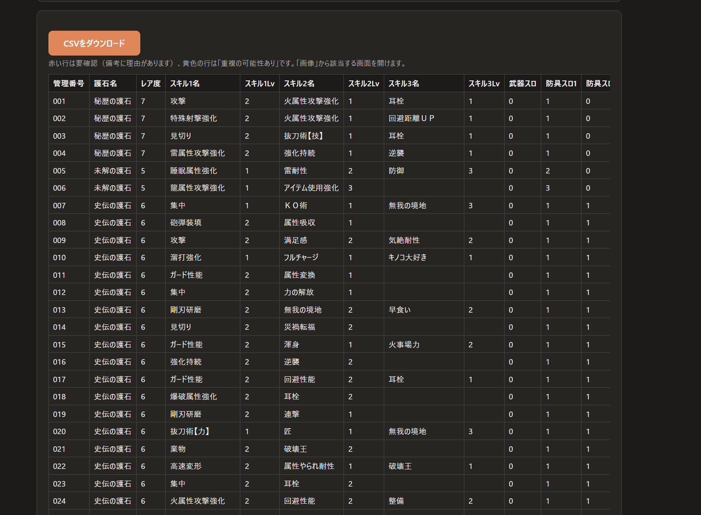
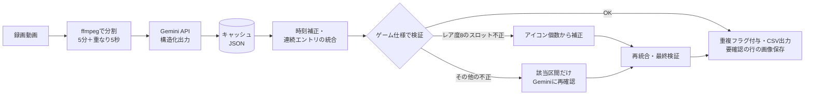
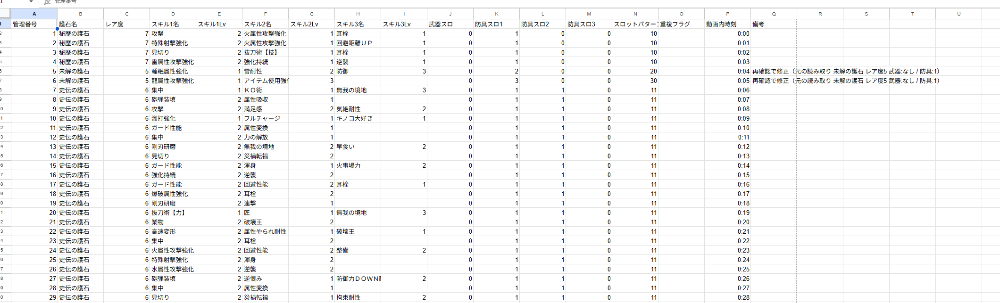

# charm_extractor

**ゲーム画面の録画から、護石（装備アイテム）の一覧表を自動で作るツール**

モンスターハンターワイルズ（MHWilds）では護石を大量に集めることになりますが、ゲーム内の並べ替えや絞り込みは機能が限られています。このツールは、護石の「装備詳細」画面を順番に映した録画動画を Gemini API で読み取り、1つの護石＝1行の CSV にします。スプレッドシートで自由に並べ替え・フィルタできるようになります。



> 非公式のファンツールです。株式会社カプコンとは関係ありません。

## 特徴

- **動画を選ぶだけ**：ローカルの Web 画面に動画をドラッグ＆ドロップすると、CSV ができます。起動は `start.bat` のダブルクリックだけです。
- **LLM の読み取りを検証する**：ゲーム仕様（レア度ごとの護石名・スロットパターン・スキル数）と照らし合わせ、仕様に合わない読み取りを自動で検出します。そのうえで補正するか、該当する区間だけを Gemini に聞き直します。
- **長い動画に対応**：チャンクに分割して解析し、Gemini の応答をキャッシュします。途中で失敗しても続きから再開でき、API を呼ばずに CSV だけ作り直すこともできます。
- **人が確かめやすい**：要確認の行は理由を備考に書き、その時刻の画面を PNG で保存します。Web 画面の結果の表から、その画像をすぐ開けます。

## 処理の流れ



## 設計で工夫した点

### 「映り続け」と「同じ護石を複数持っている」を区別する
動画では、同じ護石の画面が数秒映り続けます。一方で、まったく同じ護石を実際に2つ持っていることもあります。動画だけでは確実に見分けられないので、次のルールにしました。
- Gemini には「画面が切り替わるたび」のエントリを、開始秒・終了秒つきで返させる
- 内容が同一で、間隔が数秒以内のエントリは1行に統合する（チャンクの重なりで二重に検出された分も、これで吸収される）
- 間に別の護石が挟まっていれば別の行として残し、内容が完全に同じ行すべてに「重複の可能性あり」を付けて、最終判断は人に任せる

### LLM の誤読を前提にした検証と補正
実際に動かすと、スロットアイコン（剣マーク＝武器、頭マーク＝防具、〇の数＝レベル）の読み間違いが多く出ました。アイコンの個数は合っているのに、種類やレベルを取り違えるパターンです。そこで次の対策を入れました。
- ゲーム仕様を [talisman_rules.py](talisman_rules.py) に切り出し、プロンプトにも検証にも同じ定義を使う（パッチで仕様が変わってもこのファイルだけ直せばよい）
- プロンプトでは「まずアイコンの個数を数える → 種類を見分ける → レベルを読む → 仕様に合うか確かめる」という手順を踏ませる
- レア度8はアイコンの個数でパターンが一意に決まるので、仕様に合わなければ個数から補正する
- それ以外の不正な行は、前後数秒だけを切り出し、スロットに集中したプロンプトで1回だけ聞き直す
- 補正や再確認をしても、キャッシュには Gemini の生の応答を残す（あとから検証ルールを変えて作り直せるように）

### キャッシュと再現性
- キャッシュのキーは、動画の中身（先頭・末尾のハッシュ）と、モデル・分割設定・プロンプトのバージョンから作る。ファイル名を変えても再利用でき、プロンプトを変えれば自動で解析し直す。
- `--rebuild-from-cache` で、API を呼ばずに CSV を作り直せる（CSV の列構成を変えたときに使う）。

## 技術スタック

- Python 3.12
- [google-genai](https://pypi.org/project/google-genai/)（Gemini API：Files API、動画入力、JSON スキーマによる構造化出力）
- ffmpeg / ffprobe（分割・フレーム切り出し）
- Flask（ローカル専用の Web 画面）
- unittest ＋ GitHub Actions

## セットアップ（Windows）

1. **Python 3.10 以上**をインストールします。
2. **ffmpeg** をインストールします。
   ```powershell
   winget install Gyan.FFmpeg
   ```
3. **Gemini API キー**を [Google AI Studio](https://aistudio.google.com/apikey) で発行します。キーは Web 画面に毎回入力するか、環境変数 `GEMINI_API_KEY` に設定します（コードやファイルには書きません）。
   ```powershell
   [Environment]::SetEnvironmentVariable("GEMINI_API_KEY", "取得したキー", "User")
   ```

Python のライブラリは、初回起動時に `start.bat` が仮想環境（`.venv`）を作ってインストールします。

## 使い方

### ブラウザ
1. `start.bat` をダブルクリックすると、ブラウザで `http://127.0.0.1:5000/` が開きます。
2. 動画をドラッグ＆ドロップして「解析開始」を押します。
3. 結果の表を確認し、「CSVをダウンロード」を押します。赤い行は要確認、黄色の行は重複の可能性ありです。
4. CSV と画像は `outputs\<動画名>\` に保存されます。

サーバーは `127.0.0.1` で動くので、この PC からしかアクセスできません。外部に送るのは、Gemini に送る分割済みの動画だけです。

### ターミナル
```powershell
.\.venv\Scripts\python.exe charm_extractor.py 入力動画.mp4 出力.csv
.\.venv\Scripts\python.exe charm_extractor.py 入力動画.mp4 出力.csv --save-flagged-frames   # 要確認の行の画面をPNG保存
.\.venv\Scripts\python.exe charm_extractor.py 入力動画.mp4 出力.csv --rebuild-from-cache    # APIを呼ばずにCSVを作り直す
```

## 出力 CSV（UTF-8 BOM 付き）

| 列 | 内容 |
|---|---|
| 管理番号 | 001 からの連番 |
| 護石名 / レア度 | 例: 栄世の護石 / 8 |
| スキル1〜3の名前・Lv | 名前と Lv を別のセルに。スキルが2つの護石では、スキル3は空欄 |
| 武器スロ / 防具スロ1〜3 | 0〜3（0＝なし）。防具は大きい順に詰める |
| スロットパターン | 武器スロ＋防具スロを連結した数字列（例: 111、10、21） |
| 重複フラグ | 内容が完全に同じ行が2行以上あれば「重複の可能性あり」 |
| 動画内時刻 | 元動画でその護石が最初に映った時刻（mm:ss） |
| 備考 | 検証で見つかった問題、補正・再確認の内容、確信度の低い点 |

読み取れなかった項目は、空欄ではなく「不明」と書きます。



## 設定（`charm_extractor.py` 冒頭の定数）

| 定数 | 既定値 | 内容 |
|---|---|---|
| `MODEL_NAME` | `gemini-3.8-flash` | 使用モデル（動画入力対応の安定版） |
| `CHUNK_SEC` / `OVERLAP_SEC` | 300 / 5 | 分割の長さと重なり（秒） |
| `MERGE_GAP_SEC` | 3.0 | 同一内容のエントリを連続とみなす間隔（秒） |
| `SAMPLING_FPS` | 1.0 | Gemini に送るフレームレート |
| `MEDIA_RESOLUTION` | `None` | 文字が読みにくい場合は `"MEDIA_RESOLUTION_HIGH"` |
| `RECHECK_PAD_SEC` | 2.0 | 再確認で切り出す区間の前後の余白（秒） |
| `PROMPT_VERSION` | 2 | プロンプトを変えたら上げる（キャッシュが作り直される） |

## テスト

```powershell
.\.venv\Scripts\python.exe -m unittest test_validation -v
```
（または `run_tests.bat` をダブルクリック）

実際に誤読が多発した出力（レア度8で「武器:2 / 防具:2」「武器:なし / 防具:1,1,1」など）をテストデータにしています。次のことを確認します。
- 旧形式の文字列（例:「不明Lv1」）から、新形式のセルに分解できる
- 全行がパターン違反として検出され、正しい行では備考が空になる
- アイコン個数からの補正、再確認（1回だけ）、CSV 出力が正しい

API は使わないので、キーが無くても実行できます。

## 既知の課題

- 個数から補正するときの「1個目のアイコンが武器スロ」という前提は、まだ実機の画面で確認しきれていません。補正した行は要確認にして画像を保存しています。
- スキル名とスキルグループ（武器系・防具系）の対応データはまだ無いので、その検証は枠だけ用意しています（`check_skill_groups`）。
- スプレッドシートで開くと、管理番号の先頭の 0 が消えることがあります（CSV 自体は `001` 形式です）。

## ライセンス

[MIT](LICENSE)
